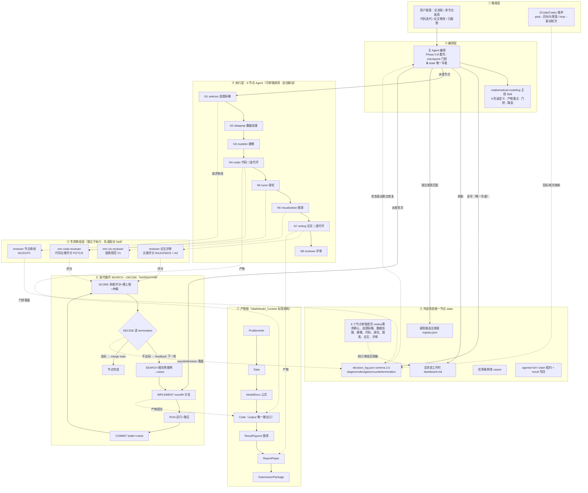

# 学术科研编排核心（academic-orchestrator）

通用学术 + 数学建模双轨的**可验证多 Agent 编排骨架**：9 阶段状态机 + 门禁体系（M1/D1/P1/P2/A1/T1/V1/**B1**/W1/A2/W2/A3）+ 迭代环（SEARCH→DECIDE）+ 审阅配对 + **后台并行派发与运行中纠正** + **运行时技能热插拔路由**。以 Codex / ZCode 等命令行 Agent 工具为宿主，全部机制基于文件（JSON 状态 + Markdown 状态页 + Skill 规范），不依赖常驻服务。

> **2.0.0 定位**：学术界主体能力（论文写作 / 深度研究 / 同行评审 / 系统综述）由 `academic-research-skills` 提供，ARIS 与 nature-* 家族按需协作；本插件只做**编排核心 + 建模子轨 + 图表对标 + 热插拔路由**，不再打包第三方重复副本。
>
> **关键架构变更**：ZCode 官方运行时禁止子 Agent 再派子 Agent（`Agent`/`Task` 从子 Agent 工具表剔除），因此编排已从 `agents/orchestrator.md`（子 Agent）迁移到 `skills/academic-orchestration/SKILL.md`（主 Agent 协议）。原设计在宿主上不可执行。

## 框架总览（架构图）



## 框架逻辑说明

1. **触发**：用户说出意图（"帮我做国赛数学建模" / "代码迭代" / "论文修改" / "只画图"），或由 goal/loop 插件驱动；**主 Agent** 依据 `academic-orchestration` 编排协议、`mathematical-modeling` 主控 Skill 与 `mm-iteration-engine` 状态引擎编排。
2. **初始化（Phase 0，前期工作）**：`state_utils.py init` 一键搭建 MathModel_Contest 标准结构并**全量预建 state**（全局状态 + 总工作栏 + 9 个节点单独首页 + 注册表 + 案例库，全部 pending），本地 `git init` 首次提交，并提醒用户创建 GitHub 远端仓库（推送由用户执行）。
3. **状态统一节点**：`state/decision_log.json`（schema 2.0，参考项目 schema 1.0 的严格超集）是唯一事实源。**单写者协议**——主 Agent 唯一写全局文件，子 Agent 只写自己的 `claim.json`（租约）与 `result.json`（写回）；写入原子替换 + seq 乐观锁；每次状态变更单独 git commit，中断后可断点恢复。
4. **节点执行与自治联动**：每个节点可**单独调用**——节点 Agent 读状态与注册表 → 前置缺失则委派上游或输出 `[PREREQ-REQUEST]` → 执行 → 自检 → 请求配对审阅 `[REVIEW-REQUEST]` → FAIL 修复（≤2 次）→ 刷新本节点首页并交付；只跑中间节点时只刷新对应首页，其余保持 pending。
5. **审阅独立于执行**：每个节点有固定配对审阅 Agent（见覆盖环节表），审阅 Agent ≠ 执行 Agent，审阅前必须加载配对 Skill 并在记录中声明；委派必须与 `registry.json` 注册表匹配。
6. **迭代循环（代码 N4/N5、论文 N7/N8）**：`SEARCH 搜优秀案例沉淀 cases → IMPLEMENT roundN 分支 → RUN 运行取证 → COMMIT 三次提交（implement/run/score，带 Round/Agent/Stage/Gate/Goal/Score trailer）→ SCORE 多维评分（硬上限+仲裁）→ DECIDE`。评分 ≥ pass 才 merge 回 main；不达标携带 feedback 进入下一轮；达轮数上限或平台期保留历史最优并升级人工。
7. **评分体系（termination 可配置）**：代码环五维（正确性30/效率15/可读性15/鲁棒性20/创新性20，默认 pass 7.0 / target 8.0 / ≤5 轮）；论文环国赛五维（假设15/创造性25/结果30/表述20/格式10，默认 pass 6.5 / target 7.5 / ≤4 轮）。评分挂 `git notes --ref=score`，可横向对比各轮。
8. **产物链**：按标准结构落盘（`ProblemInfo → Data → ModelDocs → Code（output 唯一输出口）→ ResultFigures（论文级图库去冗余）→ ReportPaper → SubmissionPackage`），每阶段产物 + 门禁通过后才推进，最终交付论文与提交清单。

## 覆盖环节

| 阶段 | 环节 | Agent | Skill | 配对审阅 Agent |
|:----:|------|-------|-------|---------------|
| 0 | 项目初始化（标准结构+state 预建+git） | 主 Agent（main-agent） | mathematical-modeling + mm-iteration-engine | — |
| 1 | 选题与赛题拆解 | selector | mm-problem-analysis | reviewer（节点审阅，门禁 M1 + 人工 H1） |
| 2 | 数据预处理 | dataprep | mm-data-preprocessing | reviewer（节点审阅，门禁 D1） |
| 3 | 模型搭建 | modeler | mm-model-library | reviewer（节点审阅，门禁 P1） |
| 4 | 算法代码开发（迭代环） | coder | mm-algorithm-dev + mm-iteration-engine | **mm-code-reviewer**（门禁 P2 + A1 + H2 + S） |
| 5 | 模型迭代调优 | tuner | mm-model-tuning + mm-iteration-engine | **mm-code-reviewer**（门禁 T1） |
| 6 | 结果可视化 | visualization | mm-visualization | **mm-viz-reviewer**（门禁 V1） |
| 7 | 论文撰写（迭代环） | writing | mm-latex-writing + mm-iteration-engine | reviewer（论文评审，门禁 W1 + A2 + W2 + H3 + S） |
| 8 | 论文自检评审 | reviewer | mm-self-review + mm-iteration-engine | 终稿评审报告（门禁 A3 + 提交清单核对） |

## 目录结构

```
agents/          Agent 定义文件（21 个：8 节点执行 + 4 专用审阅（含图表对标）+ 学术支撑）
skills/          Skill 包（mm-iteration-engine 迭代引擎 + mathematical-modeling 主控 + 10 个 mm-* + 通用学术支撑技能；学术四技能由 academic-research-skills 插件提供）
  mm-iteration-engine/   迭代引擎：状态节点 schema 2.0、节点首页、审阅配对、迭代循环、git 规范
    scripts/state_utils.py   状态节点命令行助手（init/node-review/round-score/round-decide/result-validate/result-ingest 等）
    templates/               状态模板 + 标准项目结构定义
mcp/             MCP 集成层（Checkpoint 0 启动协议 + 四类 MCP 分工 + 调用层级 + 闭环校验 + Tavily 双密钥配置 + 知识卡片/GB/T 7714 台账模板）
shared/          ARS 参考语料/契约/任务原则清单（handoff_schemas / compliance_checkpoint / 模型分级等）
scripts/         仓库级工具（lint_contracts.py 契约检查 + mcp_boot_check.py MCP 自检 + ARS 文献客户端与校验脚本）
spec/            机器可读协议（result.schema.json / review_protocol.json / sync_compatibility.json）
tests/           契约与回归测试（python -m unittest discover -s tests -p 'test_*.py'）
.github/         CI 工作流（contracts.yml：编译 + 契约 + 测试矩阵）
pyproject.toml   项目元数据与版本单一来源
templates/       国赛论文 Word/PDF 模板
docs/            文档导航（docs/README.md）→ 迭代工作流说明 + 冒烟验证报告；历史文档见 docs/archive/
能力盘点.md       本地组件全量清单与差距分析
```

**9 个核心 Agent 中 5 个为双模式合并版**（学术通用能力 + 数学建模能力融合）：orchestrator（建模编排 + 4 条学术工作流）、coder（竞赛迭代模式 + 通用 TDD）、visualization（竞赛图表 + 出版级 APA）、writing（国赛 10 节 + 通用 TEEL）、reviewer（论文评审 + 节点审阅 + 通用代码审查）。

**2 个专用审阅 Agent**（迭代引擎新增，审阅独立于执行）：`mm-code-reviewer`（代码/算法五维评分 + 硬上限 + 仲裁，门禁 P2/T1）、`mm-viz-reviewer`（V1：5 项预检查 + 20 项编号质量检查，含图库去冗余与数据同源抽查）。

## MCP 集成层（🎯 插件启动强制初始化 · Checkpoint 0）

系统内嵌四类 MCP 作为**插件原生常驻能力**，随插件生命周期自动就绪。任何建模任务开工前必须跑通 Checkpoint 0：

```
① 全局 MCP 扫描（以本机真实注册为准）→ ② 筛选四类适配 MCP → ③ 插件内嵌封装 → ④ 自检就绪 → ⑤ 允许建模任务启动（顺序不可逆、不可跳过）
```

| 类别 | 内置 MCP | 专项 |
|------|---------|------|
| 论文搜索 MCP | `paper-mcp`（paper_search / download_paper / vpn_login） | 文献检索 & 归档（核心常驻，GB/T 7714 双分支归档） |
| Context7 MCP | `context7`（resolve-library-id / query-docs） | 算法技术：模型原理/公式细节/求解器 API/优化文档 |
| GitHub MCP | `github`（仓库/代码/PR/Issue 官方 API） | 开源工程：开源项目/仿真源码/高性能实现/工程案例 |
| Tavily 全网搜索 MCP | `tavily-mcp`（内嵌双密钥轮换；未装时 `tokenhub-tools::search` 回退） | 前沿资料：数据集/行业案例/前沿算法/学术补充 |

- **启动门禁**：`/mm-boot`（或 `/mm` 第 0 步自动触发）→ `python scripts/mcp_boot_check.py --report`，`MCP_READY` 放行、`MCP_BLOCKED` 终止；
- **核心节点强制必调**：N1 选题→论文搜索+Tavily/tokenhub、N3 建模→Context7+论文搜索、N4 代码→Context7+GitHub MCP、N5 调优→GitHub MCP+Tavily/tokenhub、N7 论文→论文搜索（GB/T 7714 归档）；检索结果沉淀知识卡片（`state/reports/mcp-cards/`）+ 留痕 `state/reports/mcp-calls.jsonl`，文献入 GB/T 7714 台账 `state/reports/references-ledger.md`；
- **闭环校验**：启动 / 调研 / 建模工程 / 终检四检查点，N8 终审按 `mcp/validation-checkpoints.md` 校验闭环。
- 完整协议见 [`mcp/README.md`](mcp/README.md)。
- 数据流地图见 [docs/DATA_FLOWS.md](docs/DATA_FLOWS.md)；风险登记见 [docs/RISK_REGISTER.md](docs/RISK_REGISTER.md)；控制可用性见 [docs/CONTROL_AVAILABILITY.md](docs/CONTROL_AVAILABILITY.md)。
- 已示例化实现并测量：`deterministic citation-existence verification gate`（四索引引用存在性核查）、`a deterministic numeric/citation token-conservation checker`（修订声明漂移防护）、Socratic 问题表述告警的 `held-out miss rate 0.34–0.38 → 0.094 with false-fire 0/16 preserved`。承载矩阵及证据见 `docs/STAGE_CAPABILITY_MATRIX.md`。

## 与学术界主体能力的分工（2.0.0 口径）

**本插件不再持有 ARS（academic-research-skills）的任何副本。** 1.x 时期平铺进来的四技能树
（`academic-paper` / `academic-paper-reviewer` / `academic-pipeline` / `deep-research`）、
3 个学术 agent（`research_architect_agent` / `synthesis_agent` / `report_compiler_agent`）、
16 个 `/ars-*` 命令，已在 2.0.0 **全部移除**——它们由独立的 `academic-research-skills`
插件提供，重复分发只会造成版本漂移与双份遮蔽。

| 能力 | 由谁提供 |
|---|---|
| 论文写作 / 深度研究 / 同行评审 / 全链路编排 | 外部插件 `academic-research-skills:academic-paper` 等 |
| 编排骨架（状态机、门禁、迭代环、派发协议） | **本插件** `academic-orchestration` |
| 数据血缘与可复现（raw 锁定、血缘台账、环境锁） | **本插件** `data-lineage` 契约 + 校验器 |
| 图表/表格文献对标 | **本插件** `figure-table-benchmark` + `mm-figure-table-benchmarker`（B1 门禁） |
| 去 AI 化 / LaTeX 质检 / 图表规范 / 建模专项 | **本插件** `humanizer` / `academic-humanize` / `latex-guard` / `mm-*` |
| 其余专业能力（xlsx / pptx / docx / drawio / pdf…） | `mm-skill-router` 运行时扫描本机已装 skill；未装则记为 `unresolved` |

> 🔴 **Pro 知识库（v1.7.0 融合，仍有效）**：139 张 CUMCM 优秀论文案例卡（2012—2025）在
> `skills/mathematical-modeling/assets/case-library/`；12 份选型/验证/创新/写作决策规则
> 映射至对应 `mm-*` skill 的 `assets/pro/`；N1 选题拆解强制案例类比检索
> （`state_utils.py case-search`）。证据边界见 `corpus-provenance.md`
> （案例卡为决策记忆转述，OCR 抽样未核验内容不视为已核验，模型频次仅作检索线索）。
>
> 📌 **历史文档**：v1.5.0/v1.7.0 的优化整改记录已归档到
> `docs/archive/v1.x-optimization/`（含当时的 24/34/22 口径与取舍理由），
> **不作为现行规范**。现行组件口径以 `scripts/lint_contracts.py` 的
> `EXPECTED_COUNTS` 为准（当前 **21 Agent / 25 Skill / 7 命令**）。

## 标准项目结构（MathModel_Contest 适配版）

初始化由 `state_utils.py init` 一键生成（详见 `docs/迭代工作流说明.md`）：`state`（外部状态统一节点）、`ProblemInfo`、`Data`（raw 禁改/processed/feature/test_result）、`Code`（output 唯一输出口）、`ResultFigures`（论文级图库）、`ReportPaper/LaTeX`（唯一文档源，PDF 为编译产物）、`ModelDocs`、`SubmissionPackage`、`Material`、`LogRecord`（版本/日报/bug 记录）、`BackupArchive`、`DefenseMaterial`。

## 已有材料自动标准化接入

如果已经有论文、代码和数据，不需要手工重排目录。先初始化标准项目，再使用同步导入工具：

```bash
python shared/state-engine/state_utils.py init --dir <项目目录> --name <项目名>
python shared/state-engine/sync_import.py --source <已有材料目录> --project <项目目录>
python shared/state-engine/sync_import.py --source <已有材料目录> --project <项目目录> --apply
```

导入遵循“原始材料不覆盖、标准目录自动归档、来源和哈希可追溯”原则：代码进入 `Code/legacy/`，数据进入 `Data/raw/`，Markdown/PDF 进入 `ReportPaper/LaTeX/drafts/` 并在 `state/latex_conversion/` 生成 **BLOCKED 转换任务**（`document_to_latex`），由专用 Agent 按 `mm-latex-writing` + `latex-guard` 完成正式转换。之后必须先完成独立代码审阅和数据验证，再进行论文改写和 LaTeX 编译。

## 接手已有项目（读题 → 比对 → 验证 → 标准化修复）

接手任何已有项目（无论是否由本系统初始化）时，统一走"审计 → 修复"闭环：

```bash
python state/state_utils.py project-audit --dir <项目目录> [--source <题目原文>]
python state/state_utils.py project-repair --dir <项目目录> [--apply]   # 先预览，再 --apply 实际补建
```

`project-audit` 逐项检查：题目事实锁定（存在/漂移/与原文 SHA-256 比对）、标准结构（目录+占位文件）、9 份节点首页、registry 与 NODES 一致性、**状态-产物一致性**（completed 但产物缺失 → 级联失效；有产物但未登记 → 提示补登记）、旧命名残留。`project-repair --apply` 只补建缺失的标准设施（目录/占位文件/节点首页/registry/human_checkpoint），**绝不覆盖已有文件与状态**；题目锁定缺失或漂移时不代填，要求先 `problem_guard.py create` 重新锁定。修复后再次 `project-audit` 应收敛到仅剩待锁定/待执行项。

## 使用方式

1. 准备赛题（PDF/文本）+ 数据文件（csv/xlsx）
2. **读题与图形处理**：题目含图形时按模型能力分流——有视觉能力：`problem_guard.py figures --mode vision` 把 PDF 逐页渲染为图片交视觉模型阅读（`figures-read --mode vision`）；无视觉能力：`figures --mode human` 生成请求单发给人工详细描述（`figures-read --mode human --description ...`）。`create --figure-mode vision|human|none` 声明模式，`verify` 强制校验图形已处理。
3. 输入 `/mathematical-modeling` 或"帮我做国赛数学建模"触发主 Skill
4. orchestrator 初始化标准结构 + state 全量预建 → 按 9 阶段委托对应 agent → 每阶段产物落盘 + 配对审阅 + 门禁
5. 最终获得完整论文（ReportPaper/）+ 评审结论 + 提交清单（SubmissionPackage/）

**单独调用某节点**（如"代码迭代""论文修改""只画图"）：节点 Agent 自治联动（检查前置→执行→自检→请求配对审阅→修复→交付），状态只刷新对应节点首页。

**全自动驱动迭代环**（N4/N5/N7/N8）：先由 orchestrator 生成完整迭代序列（dry-run），宿主按序执行即可驱动 SEARCH→DECIDE 直到终止：

```bash
python shared/state-engine/orchestrator_runtime.py --plan-iteration N4 --dir <项目目录> --git
```

序列包含每轮的 `round-start →（执行 Agent SEARCH/IMPLEMENT/RUN/COMMIT）→ round-score（独立审阅 Agent 评分）→ round-decide`，共 `max_rounds` 轮；前置缺失时返回 `blocked` 与缺失清单。**审阅独立铁律**：带审阅裁决的 `result.json` 必须由注册的独立审阅 Agent 提交（N8 终审为显式豁免），`result-ingest` 会在机器层面拒绝执行 Agent 自评。

**安装到 Agent 工具**（两种标准方式，任选其一）：

1. **插件方式（推荐，一次加载全部组件）**：本仓库即标准插件包——`.zcode-plugin/plugin.json`（另附 `.claude-plugin/`、`.codex-plugin/` 兼容清单）声明全部组件：`skills`（23 个 Skill，含 11 个 mm-* 建模专项 + 编排协议 + 图表对标 + 去AI化 + LaTeX 质检 + 路由层）、`agents`（21 个 Agent 定义：8 建模节点执行 + 3 专用审阅（含图表对标）+ 学术支撑）、`commands`（7 个：`/mm` 主线 6 个 + `/academic-update` 上游更新检查）；项目文档（README、docs/、CHANGELOG、CONTRIBUTING、SECURITY）随包携带。

   - **安装**：ZCode **Settings → Plugin Management → Discover** → 添加本地目录（本仓库路径）或 Git URL → 安装并启用；
   - **本地插件市场（推荐本仓库）**：本仓库根已内置 `marketplace.json`（官方本地市场清单）。在 **设置 → 插件 → 右上角 创建 → 添加插件市场**，填本仓库目录（如 `F:\deskop\mm`）或拖入文件夹 → 校验通过后插件出现在「个人」分段 → 安装并启用 `academic-orchestrator`；
   - **插件自带 MCP**：插件根 `.mcp.json` 声明四类 MCP（paper-mcp / context7 / github / tavily-mcp / tokenhub-tools 回退），启用插件后显示在 **设置 → MCP 的「Plugin MCP 服务器」分组**，随插件启停自动加载。本机 `.mcp.json` 已写入你的真实密钥与路径（已被 `.gitignore` 保护，不会提交）；可分发的占位模板见 `.mcp.json.template`（换机时复制为 `.mcp.json` 并替换 `${...}` 占位）。用户级同名 MCP 以你自己的配置为准；
   - **更新**：仓库推送新版本后，在 Plugin Management 对插件执行更新（Git URL 方式自动对齐；本地目录市场方式重新指向即可）；
   - **跨工具**：Claude/Codex 通过各自插件市场安装同一仓库（清单已兼容）。

   > **本地 marketplace 注册（换机器可复现）**：若用本地目录方式且想直接出现在"已安装"列表，需注册 marketplace——在 `~/.zcode/cli/plugins/known_marketplaces.json` 的 `marketplaces` 追加 `{"id": "academic-orchestrator", "source": {"source": "directory", "path": "<插件缓存目录>"}}`，并在该目录放 `marketplace.json`：`{"name": "academic-orchestrator", "plugins": [{"name": "academic-orchestrator", "source": {"source": "directory", "path": "<插件目录>"}, "version": "2.0.0", "icon": "🎓"}]}`；重启会话后 Installed 页可见并可开关。推送到 GitHub 后建议改用 Git URL marketplace，无需本地注册。

2. **用户级同步（个人使用，立即生效）**：将 `skills/` 与 `agents/` 同步到工具的技能/子代理目录（`~/.zcode/skills` 优先于 `~/.agents/skills`，同名 skill 用户级先加载）：

```bash
cp -r skills/* ~/.zcode/skills/ && cp agents/*.md ~/.zcode/agents/
```

> ⚠️ **与插件独占模式互斥**：本仓库根存在 `.plugin-only` 标志（当前默认启用）时，**禁止使用用户级同步**——插件独占模式下流程引用全部使用插件前缀名（`组件名`），用户级副本只会造成遮蔽/双份混乱（lint 与 self_check 会拦截并提示）。请使用脚本：`python scripts/sync_user_level.py --plugin-only`（清理用户级副本）或 `--check`（门禁校验）；两种安装方式（插件 vs 用户级同步）二选一，不要混用。

**推送远端**（含 CI 工作流）：首次推送需凭据含 `workflow` scope，否则被 GitHub 拒绝——先执行 `gh auth refresh -s workflow --hostname github.com`（浏览器确认设备码）或给 token 勾选 workflow scope，再 `git push origin main`；详见 `CONTRIBUTING.md`。

## 测试与契约检查

纯标准库、无第三方运行依赖（dev 可选 pytest）：

```bash
python scripts/lint_contracts.py                                        # 仓库级契约检查（NODES↔registry / frontmatter / 版本 / 旧命名）
python -m py_compile skills/mm-iteration-engine/scripts/*.py shared/state-engine/*.py scripts/*.py
python -m unittest discover -s tests -p 'test_*.py'                     # 状态、门禁、结果协议、导入与转换回归测试
```

契约检查覆盖：重复命令/旧命名残留、`state_utils.py` 的 NODES 与 `registry.json` 双份一致、SKILL frontmatter 必填、`pyproject.toml` 与脚手架/Skill 版本单一来源、LaTeX 初始化结构。CI（`.github/workflows/contracts.yml`）在 Python 3.9–3.13 上执行同样三步。

## 组件来源

- `agents/`、`skills/` 中的支撑副本：来自本地原有 Agent 工具体系，作为学术通用能力底座
- 数学建模专用 agent/skill：本项目开发（含迭代引擎与 2 个专用审阅 Agent）
- `ref/`：GitHub 开源参考项目（Linference/math_model 数学建模多智能体系统，状态 schema 与评分体系蓝本）
- `templates/`：国赛论文模板

## 外部依赖与上游仓库（换机器首次安装必读）

本插件把**学科能力**委托给外部 skill 库与自己维护的 pipeline 流程，插件本体只做编排与门禁。
机器换台后这些外部依赖**不会自动出现**，必须先装齐再启用插件，否则节点会因技能缺失而卡住。

机器可读的唯一事实源是 [`upstream-sources.json`](upstream-sources.json)（`sources[]` 含 tier/kind/repo/install/local_path），
下表是它的可读视图；两者不一致时以 JSON 为准。

### 必需（缺任一 → 核心节点无法执行）

| 依赖 | 类型 | 上游仓库 |
|---|---|---|
| academic-research-skills | 插件（论文/深度研究/同行评审/全链路/系统综述） | https://github.com/Imbad0202/academic-research-skills |
| ARIS | 技能库（科研全流程 87 子技能） | https://github.com/wanshuiyin/Auto-claude-code-research-in-sleep |
| nature 家族 | 技能库（写作/检索/精读/交付矩阵） | https://github.com/Yuan1z0825/nature-skills |
| figure-pipeline | 流程（随本仓库分发，`skills/figure-pipeline/`） | 无独立仓库，本仓库内置 |

### 推荐（图表/绘制能力增强）

| 依赖 | 类型 | 上游仓库 |
|---|---|---|
| scipilot-figure-skill | 技能 | https://github.com/Haojae/scipilot-figure-skill |
| figures4papers | 技能 | https://github.com/ChenLiu-1996/figures4papers |

### 可选

| 依赖 | 类型 | 上游仓库 |
|---|---|---|
| voice-pipeline | 流程（随本仓库分发，`skills/voice-pipeline/`；含可选豆包语音服务） | 无独立仓库，本仓库内置 |
| drawio-skill | 技能 | https://github.com/Agents365-ai/drawio-skill |
| codex-visio-paper-figure-skill | 技能 | https://github.com/pengjunchi0/codex-visio-paper-figure-skill |
| paper-framework-figure-studio-pro | 技能 | https://github.com/c-narcissus/paper-framework-figure-studio-pro |
| nsfc-agent-skills | 技能库 | https://github.com/njzjz/nsfc-agent-skills |
| AI-Research-SKILLs | 技能库 | https://github.com/Orchestra-Research/AI-Research-SKILLs |
| scientific-agent-skills | 技能库 | https://github.com/K-Dense-AI/scientific-agent-skills |
| Research-Paper-Writing-Skills | 技能库 | https://github.com/Master-cai/Research-Paper-Writing-Skills |
| ppt-master | 技能 | https://github.com/hugohe3/ppt-master |
| Humanizer-zh / anti-defensive-writing / agent-reach | 技能（LOCAL_ONLY，无公开仓库，需本地已有） | — |

> 表中 URL 均由 `git remote get-url origin` 在本机实测确认（见 JSON 的 `verified_by` 字段）。
> 本地已有路径记录在 JSON 的 `local_path`，只作参考，**不要**写进任何脚本或配置。

### 首次安装顺序

1. 装宿主（ZCode / Claude Code / Codex CLI）。
2. 装必需插件 `academic-research-skills`（走各自插件市场）。
3. clone 技能库到 skills 根：ARIS、nature 家族；本仓库自带的 figure-pipeline / voice-pipeline 随插件一起就位。
4. 按需装可选能力（drawio / figures4papers / visio / nsfc / ppt-master…）。
5. 配 MCP（paper-mcp、github、context7 等，见 `mcp/`，详见下文「MCP 集成」）。
6. **跑自检**：

```bash
python scripts/preflight.py            # 只报问题，退出码仅在被 BLOCKED 时为 1
python scripts/preflight.py --json     # 机器可读报告
```

`preflight.py` 逐项检查：目录存在性、`SKILL.md` frontmatter 是否合法（name/description 必填、
description ≤1024、未知键会让技能永不自动加载）、插件缓存是否落地、MCP 是否已配、契约 lint。
状态含义：`READY`（可用）/`DEGRADED`（可选依赖缺失，可继续）/`BLOCKED`（必需依赖缺失，必须先补）。

技能库更新走各自仓库的 `git pull`，插件不做二次封装；`scripts/check_upstream_updates.py`
按 commit 比对列出哪些上游已漂移（需网络）。
